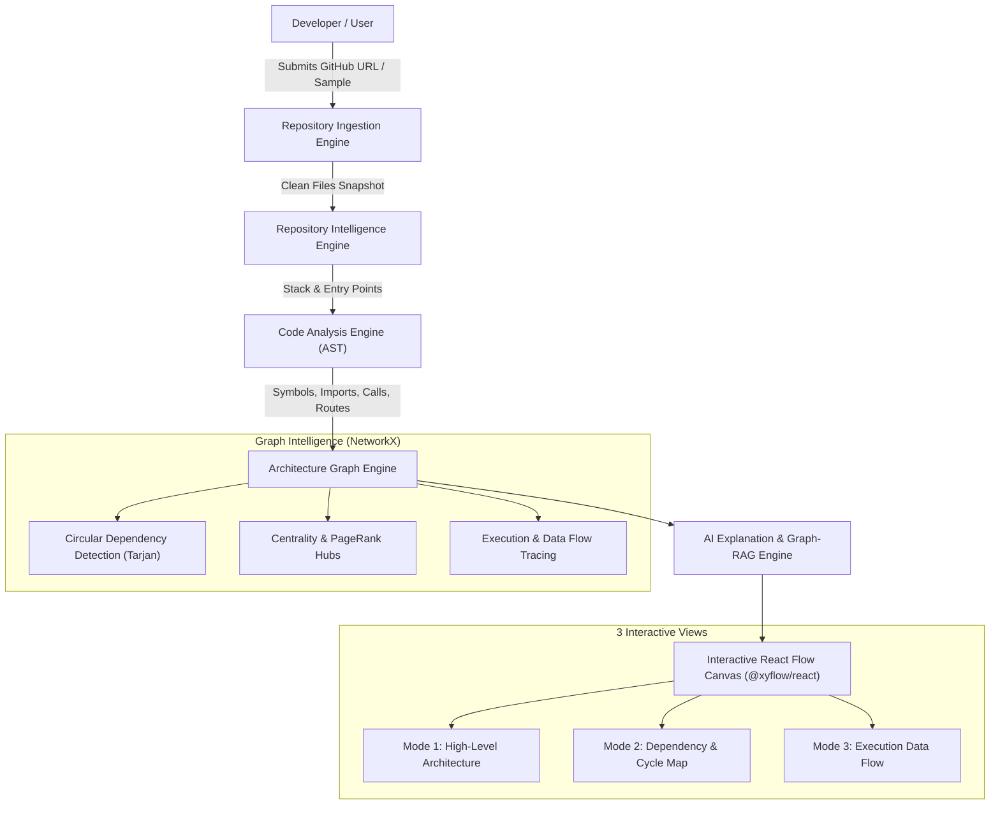

<div align="center">

# ⚡ TraceFlow Map
### *Codebase-to-Architecture Visualizer & Code Intelligence Engine*
**AI + Developer Tools + Code Intelligence**

[](https://python.org)
[](https://fastapi.tiangolo.com)
[](https://react.dev)
[](https://reactflow.dev)
[](https://tailwindcss.com)
[](https://networkx.org)
[](LICENSE)

*An interactive X-ray machine for software repositories.*

</div>

---

## 🌟 Overview

When developers or students explore an unfamiliar GitHub repository, they are confronted with hundreds of files, deep directory trees, and complex imports. Existing tools either produce static file trees or superficial LLM summaries that lack structural grounding.

**TraceFlow Map** bridges this gap:
> **Give it any GitHub repository URL (or local directory). It reads the source code, reconstructs the relationships between components via AST parsing, visualizes how the system works across 3 distinct modes, and explains the architecture in adaptive language.**

---

## 🚀 Key Features

### 1. 🔀 Triple-Mode Interactive Visualization
* **Mode 1 — High-Level Architecture View**:
  * Clusters repository components into 4 distinct architectural tiers: **Client Layer**, **API Gateway & Routing**, **Service & Business Logic**, and **Data & Persistence Layer**.
* **Mode 2 — Dependency View**:
  * Visualizes file-to-file imports, caller/callee relations, and cross-file dependencies.
  * **Tarjan Circular Dependency Detection**: Identifies architectural cycles ($A \rightarrow B \rightarrow A$) and pulses red with warning badges.
  * **PageRank Central Hubs & God Files**: Pinpoints heavily coupled core modules.
* **Mode 3 — Execution & Data Flow View**:
  * Reconstructs end-to-end request pipelines (e.g. `Client Form` $\rightarrow$ `POST /api/checkout` $\rightarrow$ `orderController` $\rightarrow$ `orderService` $\rightarrow$ `Database Commit`) with animated pulsing signals.

### 2. 🔬 Deterministic Static Analysis (AST First, AI Second)
* Zero-hallucination guarantee: Relationships are extracted directly from code syntax trees (**Python `ast`**, **TypeScript/JavaScript Tokenizer & Regex**, and **Express/FastAPI route recognizers**).

### 3. 🎓 Adaptive Persona Explanations
* Explanations adjust dynamically to the reader's expertise:
  * **Beginner**: High-level real-world analogies (e.g., kitchen, waitstaff, pantry) with no coding jargon.
  * **Intermediate**: Software architecture patterns, component responsibilities, and system design concepts.
  * **Developer**: Concrete methods, compilation units, parameters, line ranges, and state mutations.

### 4. 💬 Graph-Grounded Code RAG ("Ask Codebase")
* Conversational AI assistant grounded in topological graph neighborhoods and AST extracted code snippets, providing clickable file and line-range citations.

### 5. ⚡ 1-Click Built-in Demo Sample
* Includes a pre-configured multi-tier microservice sample repo (`sample_repo/`) so evaluators and hackathon judges can experience the entire pipeline with 1 click, even without internet or an external API key.

---

## 🏗️ System Architecture



---

## 📂 Repository Structure

```
TraceFlow_map/
├── README.md               # You are here
├── run.py                  # Single-command runner (server + tests)
├── backend/                # FastAPI backend & code intelligence engines
│   ├── main.py             # REST API server & background job pipeline
│   ├── config.py           # Environment settings & thresholds
│   ├── requirements.txt    # Python dependencies
│   ├── models/             # Pydantic v2 schemas
│   │   └── schemas.py
│   ├── services/           # 11 Modular Intelligence Subsystems
│   │   ├── github_service.py      # Repository download & caching
│   │   ├── repo_scanner.py        # File classification & filters
│   │   ├── stack_detector.py      # Frameworks & patterns detection
│   │   ├── parser_engine.py       # Python AST & TS/JS token parsing
│   │   ├── import_resolver.py     # Cross-file symbol resolution
│   │   ├── call_graph_engine.py   # Function-to-function call graph
│   │   ├── dataflow_engine.py     # Endpoint-to-DB trace generator
│   │   ├── graph_engine.py        # Mode 1, 2, 3 graph builder
│   │   ├── graph_analyzer.py      # NetworkX cycle & centrality analysis
│   │   ├── ai_explainer.py        # 3-level persona explanations
│   │   └── graph_qa.py            # Graph-grounded conversational RAG
│   ├── storage/
│   │   └── store.py               # In-memory & SQLite cache store
│   └── tests/
│       └── test_engine.py         # Automated pytest suite
│
├── frontend/               # React 18 + Tailwind + React Flow UI
│   ├── index.html
│   ├── package.json
│   ├── vite.config.ts
│   └── src/
│       ├── App.tsx                # Master 3-column workspace layout
│       ├── api.ts                 # Backend API client
│       ├── types.ts               # TypeScript data definitions
│       └── components/
│           ├── Header.tsx         # Input, mode tabs & export button
│           ├── LeftSidebar.tsx    # Stack badges, stats & cycle alerts
│           ├── GraphCanvas.tsx    # React Flow interactive canvas
│           ├── RightInspector.tsx # Inspector, Code Viewer & AI Chat
│           ├── ExportModal.tsx    # Mermaid & JSON export modal
│           └── nodes/             # Custom Tier, File, and Flow cards
│
└── sample_repo/            # Built-in demo application for instant testing
    ├── package.json
    ├── client/             # React storefront with fetch calls
    ├── server/             # Express API with intentional cycle demo
    └── py_backend/         # Python FastAPI inventory microservice
```

---

## ⚡ Quickstart & Setup

### Prerequisites
* **Python**: 3.10 or higher
* **Node.js**: v18 or higher (optional if running pre-built frontend)

### Option 1: One-Command Start (Recommended)

1. **Install backend dependencies**:
   ```bash
   pip install -r backend/requirements.txt
   ```

2. **Run backend verification tests**:
   ```bash
   python run.py --test
   ```

3. **Start the server**:
   ```bash
   python run.py
   ```
   * The server starts at `http://localhost:8000`
   * API documentation available at `http://localhost:8000/docs`

---

### Option 2: Running Frontend in Development Mode

1. In a separate terminal, install and start the Vite development server:
   ```bash
   cd frontend
   npm install
   npm run dev
   ```
2. Open your browser at `http://localhost:5173`.
3. The Vite dev server proxies API calls automatically to `http://localhost:8000`.

---

## 🔌 API Reference

| Method | Endpoint | Description |
| :--- | :--- | :--- |
| `POST` | `/api/repositories/analyze` | Initiates analysis of GitHub repo or built-in sample |
| `GET` | `/api/analysis/{id}/status` | Check job progress (`progress: 0..100`, stage message) |
| `GET` | `/api/analysis/{id}/overview` | Returns tech stack, detected patterns, LOC, and AI summary |
| `GET` | `/api/analysis/{id}/graph` | Returns nodes and edges (`?mode=architecture\|dependency\|flow`) |
| `GET` | `/api/analysis/{id}/files` | Returns filtered repository file list |
| `GET` | `/api/analysis/{id}/file/{path}` | Retrieves source code, symbols, callers, and AI explanation |
| `GET` | `/api/analysis/{id}/issues` | Returns detected circular dependencies, God files, and hubs |
| `GET` | `/api/analysis/{id}/flows` | Returns available execution and data flow traces |
| `POST` | `/api/analysis/{id}/ask` | Graph-grounded AI query (`persona=beginner\|intermediate\|developer`) |

---

## 🏆 Hackathon Winning Criteria Addressed

1. **Depth over Superficiality**: Rather than a simple prompt to an LLM, TraceFlow Map combines **static AST parsing**, **import resolution**, **graph algorithms (Tarjan, PageRank)**, and **grounded RAG**.
2. **High Polish UI/UX**: Built with `@xyflow/react` and custom glowing nodes matching developer tooling standards (Linear / Vercel dark mode aesthetic).
3. **Accessibility**: Bridges senior architect level insights with beginner learning analogies through one-click persona switching.
4. **Failsafe Demos**: Built-in sample repo and deterministic heuristic fallbacks guarantee 100% presentation uptime.

---

## 📄 License
This project is licensed under the MIT License — see the [LICENSE](LICENSE) file for details.

